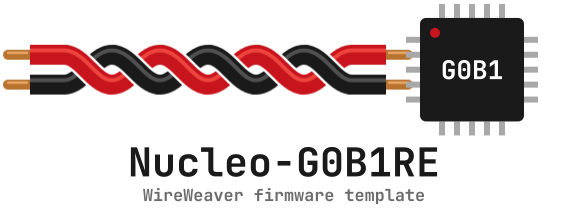
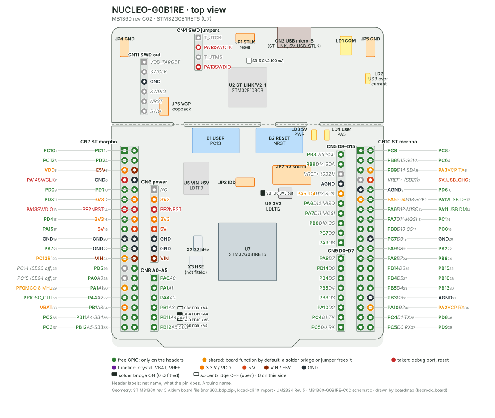

# Nucleo-G0B1RE firmware template

<p align="center">
<picture>
  <source media="(prefers-color-scheme: dark)" srcset="docs/logo/logo-dark.svg">
  
</picture>
</p>

A complete, working starting point for a [WireWeaver](https://github.com/vhrdtech/wire_weaver) device on the
[ST Nucleo-G0B1RE](https://www.st.com/en/evaluation-tools/nucleo-g0b1re.html) board (STM32G0B1RE, Cortex-M0+):
firmware, a typed API, a Rust client library, a command line and a Python module, all from one API definition.
Use it as a GitHub template ("Use this template"), rename it, add your own methods, properties and streams.

The firmware was generated by the [embedded_bedrock](https://github.com/romixlab/embedded_bedrock) firmware
template and talks to the PC through the board's own ST-LINK (RTT), so nothing but the Nucleo and its USB cable
is needed. The same layout fits a board with a USB connector by switching the transport (`bedrock_fw.json` records
the generator answers; see AGENTS.md).

| directory | |
|---|---|
| `nucleo_g0b1re_api/` | `#![no_std]` API crate: the `NucleoG0b1reApi` trait and its data types, shared by the firmware and every host |
| `firmware/` | the firmware (embassy, defmt): `src/ww.rs` implements the API, `src/settings.rs` the settings store, `src/last_reset.rs` the crash record |
| `nucleo_g0b1re_client/` | Rust client library: typed methods over the generated WireWeaver client |
| `nucleo_g0b1re_cli/` | `g0b1re`, the command line over the library |
| `nucleo_g0b1re_py/` | `nucleo_g0b1re`, the Python module over the library (PyO3, maturin) |
| `scripts/rename.py` | gives the project your own name, `just rename` |

What the firmware has from the start: a WireWeaver API over RTT with the device contract (firmware name, version,
commit, build id; last reset cause with the crash record of a HardFault or panic; a label stored in flash), a
settings store in the last 8 KiB of flash with ECC-safe reads, `cnt` event counters in RAM and in backup registers,
flip-link stack overflow protection, the ES0548 dual-bank prefetch guard. [FEATURES.md](FEATURES.md) lists all of it
with its status; [CHANGELOG.md](CHANGELOG.md) the changes.

## The board



Green pins are free, orange ones have a job on the board by default that a solder bridge removes (PA2/PA3 go to
the ST-LINK's virtual COM port, PA5 drives LD4, PC13 is the USER button, PF0 carries the ST-LINK's 8 MHz MCO), red
ones are the debug port and reset. [docs/board/](docs/board/) has the bottom view with every solder bridge and its
default, the power tree (USB, VIN, E5V, the JP2 selection, the regulators) and
[the pin table](docs/board/nucleo_g0b1re-pins.md) with a note per pin; `just board` re-draws them from
`docs/board/nucleo_g0b1re.toml` with [boardmap](https://github.com/romixlab/embedded_bedrock) (bedrock_board).

**B1, the user button:** PC13, pulled up to VDD through R29 (reads `1`) and pulled to GND when B1 is pressed
(reads `0`); SB20 (ON by default) ties B1 to PC13, OFF frees the pin (UM2324 §6.11; R29/SB20 nets from the
MB1360-G0B1RE-C02 schematic).

**LD4, the user LED:** PA5 drives it through a MOSFET (T2), high lights it, SB22 (ON by default) wires PA5 to
it (UM2324 §6.10 point 4). PA5 is also `TIM2_CH1_ETR` (alternate function 2, STM32G0B1xx datasheet DS13560): a
PWM there can breathe the LED instead of a plain on/off GPIO. **LD1 (COM)** is driven by the ST-LINK/V2-1
itself, not the target MCU, and blinks red/green to show USB enumeration and PC↔ST-LINK↔STM32 communication
state; **LD3 (PWR)** is on whenever the board's 5 V rail is present (UM2324 §6.10 points 1 and 3).

**CN4, the SWD target jumpers:** both ON (default) route the ST-LINK/V2-1's SWD to the on-board STM32G0B1RE;
both OFF route it out to CN11 instead, to program or debug an external target board (UM2324 §6.4.3, §6.4.4,
Table 6). Don't wire CN11 while CN4 is ON, it can disturb the on-board link.

## Setup

With [just](https://just.systems/man/en/packages.html) and [uv](https://docs.astral.sh/uv/getting-started/installation/)
installed (Windows: `winget install Casey.Just` and
`winget install astral-sh.uv`):

```sh
just setup               # rustup, the thumbv6m-none-eabi target, probe-rs, flip-link, cnt, ww, boardmap
just setup --check       # only report what is missing
```

`scripts/setup.py` runs on Arch, Ubuntu / Debian and Windows and skips what is already there. Before it changes
anything it prints its plan. Some steps fetch a script from the internet and run it, the way these tools are meant
to be installed: rustup's installer (`https://sh.rustup.rs`; on Windows winget installs rustup), probe-rs's installer
(on Windows its PowerShell installer, run with `irm | iex` and `-ExecutionPolicy Bypass`), and probe-rs's udev rules
file, pinned to a commit, written as root. The plan names each of them before it runs.

Steps that need root or an administrator are printed for you to run, never run behind your back: the system
packages (a C compiler, git, curl; on Windows the MSVC build tools), the udev rule that lets you open the ST-LINK on
Linux ([probe-rs](https://probe.rs/docs/getting-started/probe-setup/)) and ST's ST-LINK driver on Windows.
`just setup --root` runs them too, each shown first; `--no-probe` leaves out the probe's udev rule or driver (a build
server), `--skip TOOL` leaves out one step.

## Run

```sh
just run                 # build, flash and run the dev firmware with its defmt log (Ctrl-C: the firmware keeps running)
just cnt                 # same, but through `cnt run`: defmt log plus the event counters as they change
just flash               # release firmware through the probe
just install             # build and install the `g0b1re` command line
g0b1re info              # firmware, build id, label, last reset
g0b1re led blink -n 5
g0b1re label "bench 1"   # stored in the board's flash
g0b1re last-reset --clear
```

A probe can be opened by one program at a time: stop `just run` / `just attach` before using `g0b1re`. Connecting
scans the RAM for the RTT control block (about 1.5 s through an ST-LINK); `--elf firmware/target/thumbv6m-none-eabi/debug/nucleo_g0b1re`
(or `G0B1RE_ELF`) takes the address from the firmware's ELF instead. With several probes attached, `--probe SERIAL`
(`g0b1re probes` lists them, and the shell completes the serials: `source <(COMPLETE=bash g0b1re)`).

`cnt tui --chip STM32G0B1RETx` shows the event counters; `ww` (the WireWeaver CLI,
`cargo install --git https://github.com/vhrdtech/wire_weaver wire_weaver_cli`) can introspect and call any API
without the generated client: `ww --rtt STM32G0B1RETx introspect`.

## Python

```sh
just py                  # builds the module into nucleo_g0b1re_py/.venv, opens a prompt with the board as `dev`
just py-example          # nucleo_g0b1re_py/examples/blink.py
just test-py
```

```python
import nucleo_g0b1re
with nucleo_g0b1re.Device() as dev:         # Device(probe_serial="...", elf="firmware/target/.../nucleo_g0b1re")
    print(dev.firmware())
    dev.label = "bench 1"
    dev.blink(count=3, period_ms=400)
```

## Make it yours

1. `just rename my_board` (`just rename my_board mb` to call the command line `mb`): crates, directories, the API
   trait, the binary and its environment variables. Then read `README.md`'s prose and the `description` lines.
2. Add to the API in `nucleo_g0b1re_api/src/lib.rs`: a method, a property or a stream of the `NucleoG0b1reApi`
   trait ([WireWeaver docs](https://github.com/vhrdtech/wire_weaver/tree/master/docs)). The user button B1 (PC13) as
   a readable property is a good first one.
3. Implement it on `ServerState` in `firmware/src/ww.rs`: the compiler lists what is missing. Put the peripherals it
   needs into `ServerState` (`firmware/src/main.rs`).
4. Add a typed method to `Nucleo` in `nucleo_g0b1re_client/src/lib.rs`, a subcommand in `nucleo_g0b1re_cli/src/main.rs`
   and a method of `Device` in `nucleo_g0b1re_py/src/lib.rs`. The generated client (`board.raw()`) already has every
   item, the typed layers are for the names and errors.
5. Bump `nucleo_g0b1re_api`'s version: the crate name and version identify the API on the wire.

`just test` and `just lint` run what CI runs: the host workspace, the firmware (dev and release build) and the
Python module. `just deploy` brings a PC and the board on its probe up to `main` in one step.

## Template upgrades

`bedrock_fw.json` records the generator version and every answer; `AGENTS.md` has the upgrade procedure an agent
follows (regenerate, compare, apply what you approve). Dependencies come from git and are pinned by the two
`Cargo.lock` files (`firmware/Cargo.lock` and the root's).

## Licence

MIT, see [LICENSE](LICENSE).
